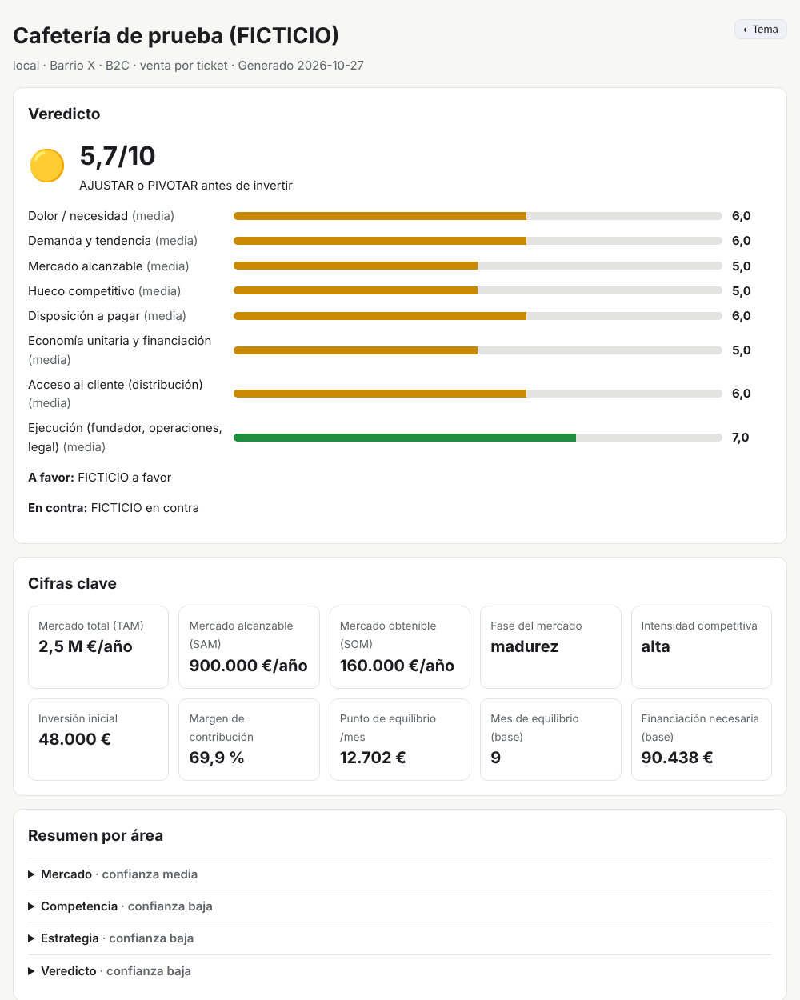
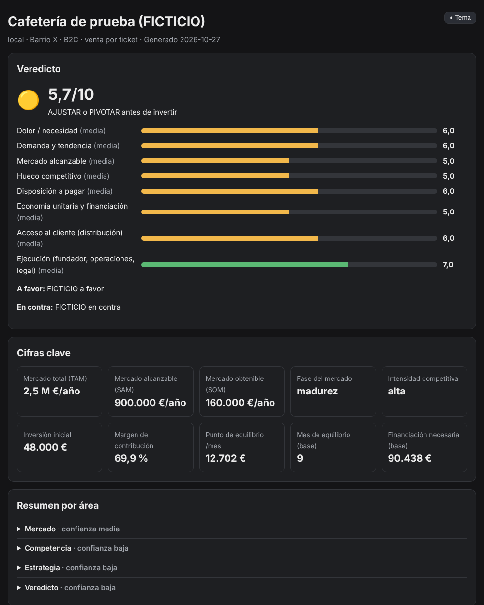

# estudio-negocio · skill `validar-negocio`

Con unos pocos prompts, Claude **investiga en Internet si una idea de negocio funciona** y te deja un estudio completo por carpetas:
- Mercado.
- Cliente y público objetivo.
- Palabras clave y demanda en buscadores.
- Competencia.
- DAFO/CAME y modelo de negocio.
- Viabilidad económica.
- Marketing y ventas.
- Producto y distribución.
- Requisitos legales.
- Riesgos y veredicto, con experimentos para validarlo barato.

Antes de investigar **te hace preguntas** para afinar la búsqueda: tipo de negocio, zona, cliente, cómo buscaría el cliente, competidores que conoces, inversión… No se queda en Google: combina la búsqueda web con lectura de páginas, APIs públicas gratuitas (INE, Eurostat, Banco Mundial, Reddit, Hacker News, App Store, Wikipedia, GDELT, autocompletado de buscadores), los conectores que tengas activos y servidores MCP gratuitos.

Cada conclusión lleva su evidencia etiquetada (`[DATO]`, `[ESTIMACIÓN]`, `[CÁLCULO]`, `[HIPÓTESIS]`, `[FUNDADOR]`, `[DESCONOCIDO]`) y su fuente con fecha. No inventa cifras ni opiniones de clientes.

## Qué entrega

```
estudios/<tu-idea>/
├── README.md        ← resumen ejecutivo: veredicto 🟢/🟡/🔴, cifras clave, riesgos, próximos pasos
├── informe.html     ← panel visual (claro/oscuro, móvil)
├── 00-brief … 10-veredicto/   ← cada área con informe.md (personas) + datos.json (IAs)
├── fuentes/         ← bibliografía con fecha y nivel de fiabilidad
└── ia/              ← contexto-ia.md (traspaso compacto para otra IA) + estudio.json (todo junto)
```

Para que te hagas una idea, así queda el panel visual con datos de prueba:

| Claro | Oscuro |
|---|---|
|  |  |

## Instalación

**Claude Code** (terminal, escritorio o web):
```
/plugin marketplace add denisky19/denisky19.github.io
/plugin install estudio-negocio@denisky-skills
```
(En versiones recientes también vale `/plugin install estudio-negocio --marketplace denisky19/denisky19.github.io`.)

**Claude Code sin plugin**: copia la carpeta `skills/validar-negocio` a `~/.claude/skills/` (para todos tus proyectos) o a `.claude/skills/` (solo un proyecto).

**claude.ai / Claude Desktop / Cowork**: descarga `dist/validar-negocio.zip` de este repositorio y súbelo en *Ajustes → Capacidades → Skills*. Activa también la ejecución de código si quieres usar los scripts.

## Cómo usarla: prompts de ejemplo

| Quieres… | Escribe |
|---|---|
| Estudio completo | `Tengo una idea de negocio: una cafetería de especialidad en Ruzafa (Valencia) con tostado propio. ¿Funcionaría?` |
| Respuesta rápida | `Valida en modo express: tienda online de ropa de segunda mano para bebés en Madrid` |
| Antes de pedir dinero | `Haz un estudio profundo de mi idea de app de reservas para fisioterapeutas autónomos en España` |
| Solo una parte | `Analiza solo la competencia de…` · `Hazme el DAFO y el Lean Canvas` · `¿Qué palabras clave buscaría mi cliente?` · `Calcula el punto de equilibrio con estos números…` |
| Cambiar supuestos | `Recalcula la viabilidad con un precio de 12 € y un alquiler de 2.000 €` |
| Seguir otro día | `Continúa el estudio de la cafetería` (lee `PROGRESO.md`) |
| Reutilizarlo | `Convierte el estudio en un plan de empresa para el banco` · `Pásale ia/contexto-ia.md a la skill de copywriting` |

## Herramientas gratuitas que la potencian (opcionales)

Todo funciona solo con la búsqueda web integrada, pero mejora mucho con:
- **Conectores de claude.ai**: Parallel Search (gratis), Exa (créditos gratis), Ubersuggest y vidIQ (freemium), y Google Drive o Notion para guardar los informes.
- **MCP en Claude Code o Desktop**:
  - Playwright: navegador para Google Maps y las bibliotecas de anuncios.
  - free-seo-mcp: Google Trends y autocompletado.
  - reddit-mcp-buddy.
  - Fetch y DuckDuckGo.
  - Data Commons: estadísticas oficiales.
  - Tavily, Firecrawl y Apify: tienen créditos gratuitos.

Comandos en [`skills/validar-negocio/referencias/conectores.md`](skills/validar-negocio/referencias/conectores.md) y configuración de ejemplo en [`conectores/mcp-gratuitos.example.json`](conectores/mcp-gratuitos.example.json).

## Cómo está hecha

- `SKILL.md`: el director. Hace la entrevista, detecta las herramientas, investiga por oleadas (en paralelo con subagentes en Claude Code), pausa para confirmar contigo los números, da el veredicto y genera los informes.
- `modulos/`: el método paso a paso de cada área, con recetas de búsqueda y formato de salida.
- `referencias/`: fuentes gratuitas por país (España, Latinoamérica, UE y global), conectores, arquetipos de negocio (local, ecommerce, SaaS, servicios, marketplace, franquicia, fabricación, infoproducto), marcos profesionales y principios de investigación.
- `plantillas/`: brief, persona, ficha de competidor, DAFO, Lean Canvas, guion de entrevista (*The Mom Test*), encuesta (Van Westendorp), experimento, modelo financiero, puntuación, esquema JSON.
- `scripts/`: utilidades en Python sin dependencias ni claves (ver [`scripts/LEEME.md`](skills/validar-negocio/scripts/LEEME.md)). Pruebas: `python3 skills/validar-negocio/scripts/pruebas/prueba_integracion.py`.

El método se basa en marcos de profesionales reconocidos:
- *Customer Development* (Blank), *Lean Startup* (Ries), *Lean Canvas* (Maurya), *The Mom Test* (Fitzpatrick).
- *Jobs To Be Done*, *Business Model Canvas* y *Value Proposition Canvas* (Osterwalder), posicionamiento de April Dunford.
- *Traction/Bullseye* (Weinberg y Mares), Porter, PESTEL, DAFO/CAME, TAM/SAM/SOM, AARRR, Van Westendorp y pre-mortem.

También en lo que hacen bien otras skills públicas; el análisis comparativo está en [`/docs/investigacion-skills-negocio.md`](../../docs/investigacion-skills-negocio.md).

## Límites honestos

- La investigación de escritorio **no sustituye hablar con clientes**. Por eso cada estudio termina con experimentos baratos.
- Los volúmenes de búsqueda gratuitos son estimaciones; los datos de terceros pueden estar desactualizados (se marcan con fecha).
- Lo legal y fiscal es orientativo: confírmalo con un gestor o abogado.
- Algunos endpoints públicos pueden bloquear redes concretas; si pasa, la skill lo dice y usa otras vías.
